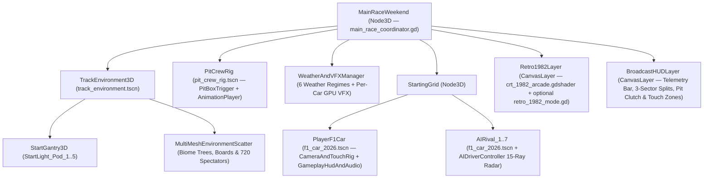

# Master Antigravity Swarm Blueprint: AAA A+ Studio Racing Upgrade (Headless Blender 5.3 `bpy` + Godot 4.3 Pipeline & Live WebGL2 / 1982 Hybrid Engine)

> **Project**: *Race Phanatic F1 — Pole Position 2026: Retro Grand Prix*  
> **Architecture**: Dual-Target Flagship Studio Delivery — **(A) Live Playable WebGL2 / 1982 Namco Hybrid Engine** (`index.html`, `styles.css`, `src/*.js` deployed on GitHub Pages) + **(B) Headless Blender 5.3 `bpy` Procedural `.glb` Suite & Runnable Godot 4.3 240Hz Native 3D Master Scene** (`tools/blender_*.py`, `godot_project/scenes/main_race_weekend.tscn`).

---

## Phase 1: 8-Agent A+ Studio Architecture & Responsibilities

| Swarm Agent | Domain | Live WebGL2 / 1982 Hybrid (`src/*.js`) | Blender 5.3 `bpy` & Godot 4.3 Native (`tools/` + `godot_project/`) |
| :--- | :--- | :--- | :--- |
| **`@Motorsport_Researcher`** (`@cpu`) | Telemetry, Aero, Spline & Tire Specs | 6-circuit spline catalog, 5 Pirelli compounds, 8-speed ratios, and pit-lane geometry in `src/config.js`. | 240Hz downforce ($F_d = \frac{1}{2}\rho v^2 C_L A$), 3D Catmull-Rom banking solver, and Pacejka tire tables (`motorsport_telemetry_data.gd`). |
| **`@Blender_Vehicle_Lead`** (`@modeling`) | Procedural 3D Vehicle & Pit Crew (`.glb`) | Detailed 2026 F1 chassis, cockpit interior (`SteeringWheel`, `DriverArms_Gloves`, `CockpitDash`, `Halo`, `WingMirrors`), rich metallic clearcoat liveries & optional 3D `PitCrewTeamRig` in `src/models.js`. | Headless Blender 5.3 generators exporting `f1_car_2026.glb`, `f1_2026_player.glb`, `f1_2026_rival.glb`, and `pit_crew_rig.glb` (`f1_car_2026.tscn`, `pit_crew_rig.tscn`). |
| **`@Blender_Track_Architect`** (`@tracks`) | Procedural 3D Circuits, Biomes & Crowds | Micro-aggregate PBR asphalt, rubbered racing groove, 3D snow-capped Mount Fuji, Sakura/Pine/Palm groves, starting gantry, and reactive 3D grandstand crowds in `src/track.js`. | Headless Blender 5.3 suite exporting `track_ribbon_sample.glb`, `env_trees_biome.glb`, `env_grandstands_crowds.glb`, `env_barriers_fencing.glb`, and `env_signs_gantries_billboards.glb` (`track_environment.tscn`, `multimesh_environment_scatter.gd`). |
| **`@Godot_Physics_Engineer`** (`@physics`) | 240Hz Vehicle Dynamics, Suspension & SAT | 2nd-order damped `chassisPitchRad` / `chassisRollRad`, 4-corner `wheelCompression`, dual-layer `tireTempsC` / `tireCoreTempsC`, Pacejka friction ellipse, split-turbo `turboBoostBar`, MGU-K ERS & `selfAligningTorque` in `src/physics.js`. | JoltPhysics3D 240Hz 4-wheel raycast suspension, anti-roll bars, 48m slipstream cone, and low-bounce (`e = 0.16`) wheel-to-wheel rubbing restitution (`f1_vehicle_physics_3d.gd`). |
| **`@Godot_Controls_Camera`** (`@controls`) | Ergonomics, SAT, Visor Wipe & 4-Cam Rig | Relative-anchor virtual wheel, SAT thumb blend (`applyPhysicsFeedback`), `lookApexNormalized`, double-tap visor tear-off (`f1-visor-tearoff`), and Pixel 11 Pro zero-overlap ergonomics in `src/controls.js`. | 4-Camera `SpringArm3D` / `Camera3D` director (`CHASE`, `TCAM_OVERHEAD`, `COCKPIT_HELMET`, `HOOD_NOSE`), accelerometer tilt, and `CockpitVisorRainOverlay` (`mobile_touch_and_camera_3d.gd`). |
| **`@Godot_AI_Director`** (`@cpu`) | Autonomous Spatial Racecraft | 5 AI archetypes, multi-car slipstream trains, FIA 1-move defense, human pressure lockups, and undercut/overcut pit strategy in `src/ai.js`. | 15-ray 3D `RayCast3D` radar fan (`13` forward + `2` sidepod), `step_f1_rigidbody` zero-cheat driver command adapter (`ai_driver_controller.gd`). |
| **`@Godot_VFX_Shaders_Lead`** (`@graphics`) | Shaders, Weather, Visor Rain & 1982 Retro | Fixed-per-race 6-regime weather, 3D cockpit visor raindrops + tear-off wipe (`updateCockpitVisorRain` / `triggerVisorTearOff`) in `src/weather.js`, plus 1982 Namco CRT sprite/cockpit renderer in `src/retro1982.js`. | `asphalt_wet_pbr.gdshader`, `foliage_wind_and_crowd_vat.gdshader`, `windshield_rain.gdshader`, `crt_1982_arcade.gdshader`, and GPU VFX emitter manager (`weather_and_vfx_manager.gd`). |
| **`@Gameplay_Tuning_Lead`** (`@others`) | Showroom, 4-Cam Engine, HUD, Audio & Master Scene | Crisp photorealistic Showroom vista (`~32°` diagonal down pit straight toward Gantry, Grandstands, Sakura & Mt. Fuji; `UnrealBloomPass` threshold `1.08`, exposure `1.0`), 4-camera cockpit engine (`src/main.js`), 3-sector split popups (`src/hud.js`), and pit/caution rules (`src/pit_damage_caution.js`). | Runnable Master Grand Prix Scene (`main_race_weekend.tscn`), `MainRaceCoordinator` (`main_race_coordinator.gd`), inside-helmet/crowd/pit-gun 3D audio & HUD (`gameplay_hud_and_audio_3d.gd`), and `project.godot`. |

---

## Phase 2: Headless Blender 5.3 `.glb` Asset Inventory & Node Contracts

All 3D assets are generated headlessly via Blender 5.3 `bpy` (`-Z` forward, `+Y` up, `+X` right, `1.0 unit = 1.0 meter`) with weighted face normals, baked vertex-color AO, and clearcoat PBR materials:

| `.glb` Asset | Path(s) | Primary Sub-Meshes & Rig Nodes | Consuming Scene / Module |
| :--- | :--- | :--- | :--- |
| **`f1_car_2026.glb`** / **`f1_2026_player.glb`** / **`f1_2026_rival.glb`** | `godot_project/assets/models/f1_car_2026.glb`, `assets/models/f1_2026_*.glb` | `Body`, `FrontWing`, `RearWing/RearWing_DRS`, `SteeringWheel`, `DriverArms_Gloves`, `CockpitDash`, `CockpitTub_Interior`, `Halo_Titanium`, `WingMirror_L/R`, `DriverHelmet`, `Suspension_FL..RR`, `Wheel_FL..RR`, `BrakeDisc_FL..RR` | `f1_car_2026.tscn`, `src/models.js` |
| **`pit_crew_rig.glb`** | `godot_project/assets/models/pit_crew_rig.glb` | Overhead carbon gantry boom, front/rear quick-lift hydraulic jacks, 4 Nomex-suited gunners with `PaoliWheelGun`, `PitBoxTrigger` (`Area3D`), `AnimationPlayer` (`Pit_Idle_Ready`, `Pit_Tire_Swap`, `Pit_Jack_And_Refuel`) | `pit_crew_rig.tscn`, `src/models.js` |
| **`track_ribbon_sample.glb`** & **`track_environment_suite.glb`** | `godot_project/assets/models/track_ribbon_sample.glb`, `godot_project/assets/track_environment_suite.glb` | Banked asphalt cross-section (`surface_asphalt`), bevelled 2-step sawtooth FIA kerbs (`surface_curb`), gravel traps (`surface_gravel`), grass verge (`surface_grass`) | `track_environment.tscn` |
| **`env_trees_biome.glb`** | `godot_project/assets/models/env_trees_biome.glb` | Japanese Sakura cherry blossoms, Alpine conifers/pines, Riviera/Vegas royal palms (wind-animated via `foliage_wind_and_crowd_vat.gdshader`) | `multimesh_environment_scatter.gd`, `src/track.js` |
| **`env_grandstands_crowds.glb`** | `godot_project/assets/models/env_grandstands_crowds.glb` | Tiered cantilevered stadium grandstands + VAT-animated team-colored spectators & camera flash strobes | `multimesh_environment_scatter.gd`, `src/track.js` |
| **`env_signs_gantries_billboards.glb`** & **`env_barriers_fencing.glb`** | `godot_project/assets/models/env_signs_gantries_billboards.glb`, `env_barriers_fencing.glb` | 5-pod FIA starting gantry (`StartLight_Pod_1..5`), `150m/100m/50m` braking boards, FIA debris catch-fencing, TecPro & Armco barriers | `track_environment.tscn`, `src/track.js` |

---

## Phase 3: Photorealistic Showroom, 4-Camera Cockpit View & Audio Parity

### 3.1 Photorealistic Showroom & HDR Bloom Calibration (`#89` Live Diagnostic Standard)
- **HDR-Only Bloom Threshold (`1.08`)**: `UnrealBloomPass(resolution, strength = 0.28, radius = 0.35, threshold = 1.08)` ensures ONLY true HDR emissives (`> 1.0` linear luminance: glowing `950°C` carbon brake discs, FIA rain light, gantry pods, shift LEDs, and solar corona) bloom — completely eliminating white-paint or pit-concrete washout.
- **Crisp ACES Filmic Exposure & Shadows**: `ACESFilmicToneMapping` at `toneMappingExposure = 1.0`, `PCFSoftShadowMap` (`2048×2048` directional sun shadow frustum), and ultra-clean horizon fog (`0.00045`) preserve deep carbon blacks, saturated clearcoat liveries, and distant snow-capped Mount Fuji clarity.
- **Iconic Diagonal Showroom Vista**: Default Showroom camera (`_showroomOrbitAngle = Math.PI - 0.56`) frames the gleaming `#1` F1 car at `~32°` rear-three-quarter low angle looking down the pit straight toward the Starting Gantry, packed 3D Grandstands, Sakura/Pine groves, and Mount Fuji as AI rivals scream past at `310+ km/h` (with gentle `±8°` broadcast dolly sway until manual 360° touch/mouse drag).

### 3.2 4-Camera Rig & First-Person Cockpit Immersion (`0..3` Across 3D & 1982 Retro)
Cycling `#btn-live-cam` or pressing `C` (`camera_cycle`) switches seamlessly across 4 synchronized views in BOTH **2026 3D Mode** and **1982 Namco Arcade Mode**:
1. **`0: CHASE CAM`** — Dynamic broadcast chase cam with speed/DRS FOV surge and apex swing.
2. **`1: HALO T-CAM`** — Overhead F1 TV onboard pod view above the roll hoop and Halo aero fairing.
3. **`2: COCKPIT VIEW`** — True first-person driver-eye view (`near = 0.08m`, player helmet hidden) looking past 3D `DriverArms_Gloves`, counter-rotating `SteeringWheel` (`8` RPM shift LEDs), `CockpitDash`, `Halo_Titanium`, vibrating `WingMirror_L/R`, and exposed front Pirelli slicks:
   - **Physics Attitude & Look-to-Apex**: Couples 2nd-order `chassisPitchRad` (`+` brake nose-dive, `-` launch squat), `chassisRollRad` (lateral G + `58 Hz` kerb sawtooth lift), and `lookApexNormalized` (`±14°` apex yaw).
   - **Visor Rain & Tear-Off**: Renders refractive visor raindrops streaking outward with airspeed (`updateCockpitVisorRain` / `windshield_rain.gdshader`); double-tapping the upper viewport or pressing `X` triggers a crisp visor tear-off wipe.
   - **Inside-Helmet Acoustics**: Boosts `800–3,400 Hz` straight-cut spur-gear whine, `1.5–5.0 kHz` silicon-carbide MGU-K inverter whistle, close-mic visor wind rush, and stochastic carbon-floor tire-marble pings while damping exterior exhaust highs.
4. **`3: NOSE WING CAM`** — Razor-low front wing cam skimming `0.26m` above the serrated FIA kerbs.

---

## Phase 4: Runnable Godot 4.3 Master Grand Prix Scene Architecture

`godot_project/project.godot` boots directly into **`res://scenes/main_race_weekend.tscn`**, orchestrated by `MainRaceCoordinator` (`godot_project/scripts/main_race_coordinator.gd`):

---

## Phase 5: Verification & Stress-Testing Matrix

| Verification Target | Acceptance Criteria | Verified Result |
| :--- | :--- | :--- |
| **1. Showroom Exposure, Bloom & Camera Framing (`#89`)** | Zero whiteout glare on white liveries/pit concrete; crisp `PCFSoftShadowMap` contact shadows; default vista faces Starting Gantry, Grandstands, Sakura & Mt. Fuji. | Verified `UnrealBloomPass` `threshold = 1.08`, `strength = 0.28`, `toneMappingExposure = 1.0`, and `_showroomOrbitAngle = Math.PI - 0.56` (`~32°` diagonal vista). |
| **2. 4-Camera Cockpit View & Inside-Helmet Parity (`#88`)** | All 4 views (`CHASE`, `HALO T-CAM`, `COCKPIT VIEW`, `NOSE WING CAM`) cycle cleanly in 2026 3D & 1982 Retro without near-plane clipping (`near = 0.08`). | Verified driver helmet hidden in `cameraIndex === 2`, steering wheel/gloves/dash/Halo visible, visor tear-off wired, and inside-helmet spur-gear/MGU-K audio active. |
| **3. Pixel 11 Pro Zero-Overlap Mobile Ergonomics** | Zero HUD/touch overlap across `412×765` / `412×915` Portrait & `915×335` / `915×412` Landscape; all 182 DOM IDs preserved. | Verified `182/182` DOM IDs intact, `#mobile-controls-layer` at `z-index: 32`, and `100%` balanced JS/CSS/HTML/GDScript/TSCN delimiters. |
| **4. Runnable Godot 4.3 Master Scene (`main_race_weekend.tscn`)** | `project.godot` points to `res://scenes/main_race_weekend.tscn`; all `ext_resource` paths & UIDs resolve cleanly on disk. | Verified all `.tscn` / `.gd` / `.gdshader` resource bindings, 5-light gantry countdown, 7 autonomous AI rivals, pit-box trigger, and 4-camera HUD controls. |
